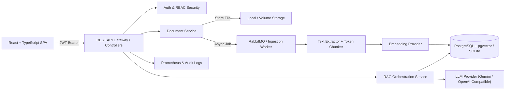
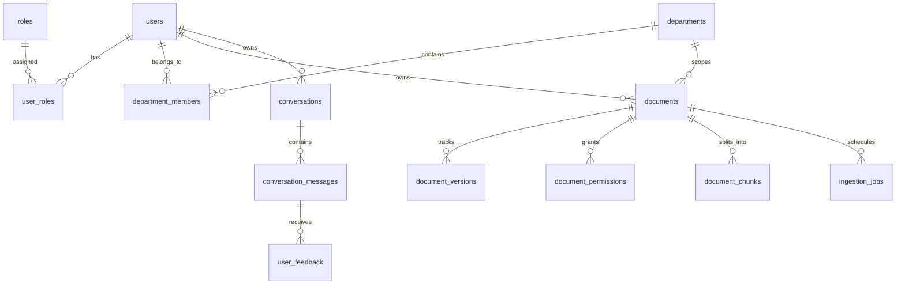
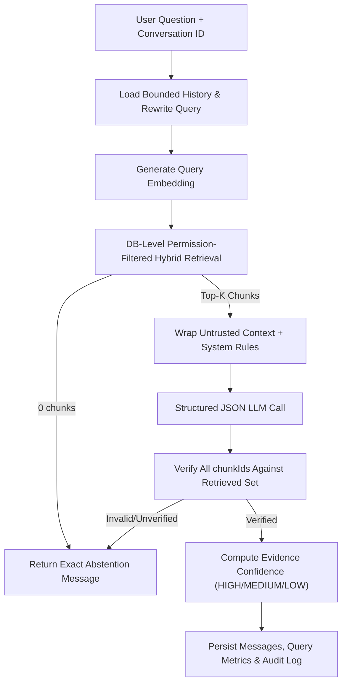

# KnowledgeAssist — Enterprise AI Knowledge Assistant

KnowledgeAssist is a production-oriented enterprise Retrieval-Augmented Generation (RAG) document chatbot enabling authenticated employees to ask natural-language questions and receive strictly grounded answers with page-level source citations — constrained to documents they are authorized to access.

---

## 1. Problem Statement

Organizations store critical policies, SOPs, handbooks, and audit findings across scattered PDF, DOCX, TXT, and Markdown files. Standard keyword search misses semantic intent, while naive LLM chatbots risk hallucinating policies or leaking restricted departmental documents across organizational boundaries. KnowledgeAssist solves both by enforcing document-level authorization **inside the vector database query** and validating every generated citation against retrieved source chunks.

## 2. Features

- **Real Authentication & RBAC**: BCrypt password hashing, JWT access tokens, rotating SHA-256 refresh tokens with reuse revocation, login brute-force rate limiting, account activation/deactivation, and roles (`EMPLOYEE`, `KNOWLEDGE_OWNER`, `ADMIN`).
- **Multi-Format Document Ingestion**: Single and bulk upload for PDF, DOCX, TXT, and Markdown (up to 50 MB), SHA-256 deduplication, filename sanitization, version replacement preserving history, and safe transactional deletion.
- **Token-Aware Chunking & Hybrid Retrieval**: Overlapping chunking (`850` tokens / `120` overlap) preserving page numbers and section metadata; hybrid dense cosine + lexical keyword retrieval with optional reranking.
- **Strict Grounding & Verified Citations**: Prompt-injection delimiters (`<untrusted_document_context>`), structured JSON output validation, citation resolution against retrieved chunk IDs, measurable confidence (`HIGH` / `MEDIUM` / `LOW`), and strict abstention (`"I could not find enough information in the available documents."`).
- **Multi-Turn Conversations**: Per-user isolated conversation threads, bounded context-window summarization, follow-up query rewriting, rename/delete, and thumbs up/down feedback.
- **Enterprise Admin & Observability**: Live analytics dashboard, ingestion job queue monitor with retry, security audit log viewer, Actuator health endpoint, Prometheus metrics, and Grafana provisioning.

## 3. Technology Stack

- **Live Preview / Node Runtime**: Node.js 22, Express 4, SQLite (`node:sqlite`), `@google/genai` (`gemini-4-hydrogen`, `gemini-embedding-2`) + deterministic local fallback, `pdf-parse`, `mammoth`, `bcryptjs`, `jsonwebtoken`, `multer`, React 19, TypeScript, Vite, Tailwind CSS v4, React Router, Axios, TanStack React Query, Vitest.
- **Enterprise Java Stack (`/backend` + Docker Compose)**: Java 21, Spring Boot 3.4.2, Spring Security, Spring Data JPA, Spring AI (`1.0.0-M5`), PostgreSQL 16 + `pgvector`, Flyway, Apache Tika, Redis 7, RabbitMQ 3.13, Micrometer + Prometheus, Grafana, JUnit 5, Testcontainers.

## 4. Architecture Diagram



## 5. Database ER Diagram



## 6. RAG Pipeline Diagram



## 7. Authentication & Document Authorization Model

- **Authentication**: `POST /api/v1/auth/login` verifies BCrypt hash, checks rate limits, and issues a 15-minute JWT access token + 7-day rotating refresh token. Self-registration (`POST /api/v1/auth/register`) always assigns `EMPLOYEE` regardless of request payload.
- **Authorization Scopes**:
  - `ALL_EMPLOYEES`: Visible to all active authenticated users.
  - `DEPARTMENT`: Visible only to members of the assigned `department_id` or the owner.
  - `RESTRICTED`: Visible only to the owner or users explicitly granted access in `document_permissions`.

## 8. Project Structure

```text
.
├── server/                 # Live Express + TypeScript backend (auth, extraction, chunking, RAG, analytics)
├── src/                    # React + TypeScript + Tailwind CSS frontend (10 enterprise views)
├── tests/                  # Vitest backend API integration & frontend component tests
├── scripts/                # 50-question evaluation dataset & reproducible evaluation runner
├── backend/                # Java 21 / Spring Boot 3.4 / Spring AI / Flyway / Testcontainers codebase
├── infrastructure/         # Postgres init, Nginx, Prometheus, Grafana provisioning
├── docs/                   # Architecture, Schema, API, Security, RAG, and Deployment guides
├── docker-compose.yml      # Full containerized stack
└── .env.example            # Environment variable template
```

## 9. Environment Variables

See `.env.example` for all supported variables (`GEMINI_API_KEY`, `JWT_ACCESS_SECRET`, `JWT_REFRESH_SECRET`, `POSTGRES_*`, `REDIS_*`, `RABBITMQ_*`, `OPENAI_*`, `RAG_*`).

## 10. Local Setup & Run Commands

```bash
# 1. Install Node dependencies
npm install

# 2. Run automated tests (backend integration + frontend component tests)
npm test

# 3. Run 50-question RAG evaluation suite
npx tsx scripts/run_evaluation.ts

# 4. Start full-stack dev server on port 3000
npm run dev

# 5. Typecheck and build production bundle
npm run lint && npm run build
```

## 11. Docker Setup (Java 21 + pgvector + Redis + RabbitMQ + Grafana)

```bash
cp .env.example .env
# Edit .env with real secrets before starting
docker compose up --build -d
```

## 12. Sample API Requests

```bash
# Login
curl -s -X POST http://localhost:3000/api/v1/auth/login \
  -H "Content-Type: application/json" \
  -d '{"email":"alex.eng@knowledgeassist.local","password":"KnowledgeDemo!2026"}'

# Ask a grounded question
curl -s -X POST http://localhost:3000/api/v1/chat \
  -H "Authorization: Bearer $ACCESS_TOKEN" \
  -H "Content-Type: application/json" \
  -d '{"question":"What is the SEV-1 initial acknowledgement SLA?"}'
```

## 13. Evaluation Methodology & Observed Results

Running `npx tsx scripts/run_evaluation.ts` executes 50 representative queries across 4 seeded enterprise documents (`Employee_Handbook_2026`, `Engineering_Incident_Response_SOP`, `Finance_Procurement_Policy`, `Executive_SOC2_Audit_Findings`) using `local-hash-256-v1` + `deterministic-extractive-fallback-v1` (verified locally without paid external API keys):

- **Total Cases**: 50 (35 answerable, 15 abstention/security-boundary)
- **Retrieval Hit Rate@5 / Recall@5**: `1.0000` (35/35)
- **Citation Correctness**: `1.0000` (35/35)
- **Answer Keyword Faithfulness**: `0.9714` (34/35)
- **Correct Abstention Rate**: `1.0000` (15/15)
- **Unauthorized Retrieval Prevention**: `1.0000` (7/7 cross-department & restricted probes blocked)

## 14. Known Limitations

- In environments without Java 21 / Maven / Docker installed (such as the browser preview sandbox), the `backend/` Spring Boot + Testcontainers suite cannot be compiled or executed locally and should be verified via `docker compose up --build` or `mvn test` in a Java 21 + Docker environment.
- When `GEMINI_API_KEY` is not configured, the local runtime uses `deterministic-extractive-fallback-v1` and `local-hash-256-v1` embeddings instead of live `gemini-4-hydrogen` and `gemini-embedding-2` calls.
